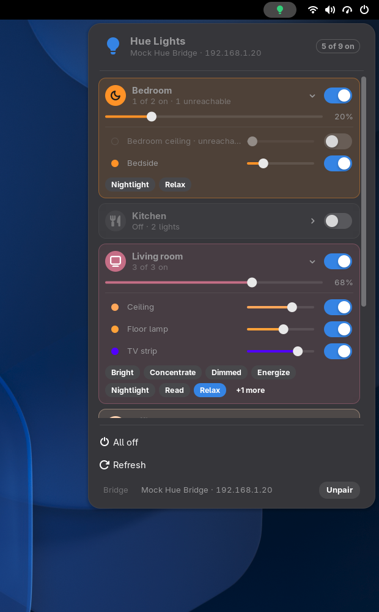

# Hue Lights for GNOME

Control your Philips Hue lights from the GNOME top bar. Switch rooms, zones and single lights on and off, set brightness and recall scenes, straight over your local Hue bridge. No cloud and no Philips account are involved.

It is a GNOME Shell extension (GNOME 51), the GNOME port of the Omarchy bar widget [Hue Lights](https://github.com/uBruckhaus/omarchy-hue-lights), and uses the same bridge helper.



- **Bar icon:** a lit bulb in green while any light is on, a dim bulb when all are off. Left click opens the panel; right click switches every light off.
- **Room cards:** one card per room and zone, with a room icon, "2 of 3 on" status and an on/off switch. Rooms that are on are tinted in the colour of their lights and show a brightness slider.
- **Single lights and scenes:** click a room to expand it: every light with its colour, a brightness slider and a switch, then the room's scenes (the active one is highlighted and always shown).
- **Unreachable lights** (for example switched off at the wall) are marked.
- **All off**, **Refresh**, and at the bottom the paired bridge with **Unpair** (click twice to confirm).

English only.

## Install

Requires GNOME Shell 51, `python3` (standard library only) and `avahi-browse` (Avahi) for finding the bridge. It never asks for root or administrator rights.

```sh
tools/build.sh
gnome-extensions install --force dist/hue-lights@ubruckhaus.github.io.shell-extension.zip
```

Log out and back in, then `gnome-extensions enable hue-lights@ubruckhaus.github.io`.

## Pairing

1. Open the panel. Hue bridges on your network are found automatically via mDNS, or enter the bridge IP by hand.
2. Click **Pair**, then press the round link button on top of the bridge within 30 seconds.

If the bridge later gets a new IP address, the extension finds it again by its bridge ID. A bridge paired from another system (for example the Omarchy widget) has to be paired once more here: each system keeps its own app key.

## How it works

A helper (`scripts/hue-lights.py`) runs while the extension is enabled. The extension sends it JSON commands over stdin (on/off, brightness, scene, pair, unpair); it answers with JSON snapshots on stdout, every 2 s while the panel is open and every 20 s while it is closed.

- **Local only:** the helper talks to the bridge's local CLIP v2 API over HTTPS on your LAN. It makes no other network requests.
- **Pinned certificate:** the bridge uses a self-signed Philips certificate. When pairing, the helper checks that the certificate name equals the bridge ID the bridge reports, and stores the certificate's SHA-256 fingerprint. Every later connection must present exactly that certificate, otherwise nothing is sent.
- **Bounded requests:** every request has one overall deadline (connect, TLS, headers and body) and a 4 MiB reply limit. `avahi-browse` runs as a fixed argument list with bounded output and a timeout; when util-linux `setpriv` is installed it is started through `setpriv --pdeathsig KILL --`, so it ends with the helper even if the helper is killed, and the helper ends it on exit or SIGTERM as well.
- **Validated commands:** light, group and scene IDs must be Hue UUIDs; the bridge address must be a private IPv4 address. Brightness is clamped to 1–100 %, and commands are rate limited as Philips recommends.
- **Sanitized text:** room, light, scene and bridge names are stripped of `<`, `>`, `&` and control characters and shown as plain text; light colours reach the panel's styles only as `#rrggbb`.
- **App key:** stored in `~/.config/hue-lights/config.json` (`$XDG_CONFIG_HOME/hue-lights`; directory `0700`, file `0600`, written atomically through a unique temp file). It never leaves the helper process.

## Differences from the Omarchy widget

- GNOME Shell extension instead of a Quickshell bar widget: GNOME switches and sliders, a scrolling room list, the bar summary as the button's accessible name (GNOME's top bar has no tooltips).
- No language setting and no plugin Information page; Unpair sits at the bottom of the panel instead of a settings page.
- The app key lives in `~/.config/hue-lights/` instead of `~/.config/omarchy/hue-lights/`, and the bridge lists the app as `gnome_hue_lights`.
- An active scene is always shown, also when it is not among the first six.
- The helper also has fixes from a review of this port: CLIP error replies count as failures, a bridge reply of an unexpected shape shows an error instead of stopping all updates, Cancel or Unpair during a pairing request cannot still save a key, `avahi-browse` ends with the helper, and a FIFO at the config path cannot block it. Later fixes, shared with the Omarchy plugin's 0.4.2: no result of a refresh, relocation, command or pairing request started before Unpair, Cancel or a new Pair is applied afterwards; non-finite numbers from the bridge are rejected; the request deadline holds after `Connection: close`; panel commands are bounded (4 KiB per line, 256 queued, one discovery at a time); bridge error texts and keys never reach the panel.

## Update or remove

```sh
gnome-extensions disable hue-lights@ubruckhaus.github.io
gnome-extensions uninstall hue-lights@ubruckhaus.github.io
```

The extension creates no services. Outside its folder it keeps `~/.config/hue-lights/config.json`. **Unpair** deletes it (or delete the directory yourself). To revoke the key on the bridge as well, remove the "gnome_hue_lights" app in the Hue app under Settings > Apps.

## Development

```sh
python3 -m unittest discover -s tests
tools/headless-test.sh panel      # paired with tools/mock-bridge.py: screenshots, switch, slider, all off
tools/headless-test.sh pairing    # unpaired: discovery, then pairing with the mock bridge
```

The headless tests run an isolated GNOME Shell and a pretend bridge (`tools/mock-bridge.py`) on this PC's LAN address and a free port (`HUE_LIGHTS_BRIDGE_PORT`); no test talks to a real bridge or switches a real light. Screenshots go to `dist/screenshots/`. The Python tests include hostile bridge replies (silent server, dripping headers, endless body, huge `Content-Length`, wrong certificate), symlinked or permissive config files and markup in names.

## License

MIT
